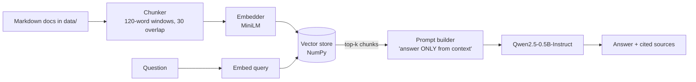

#  Space RAG — a RAG pipeline with a small local LLM

A minimal, readable **Retrieval-Augmented Generation** project that answers questions about
space exploration (Apollo, Artemis, Mars rovers, the ISS, JWST, Voyager, ISRO, reusable rockets)
using only **local, small models** — no API keys, no cloud, no GPU required.

| Component        | Choice                                    | Size      |
|------------------|-------------------------------------------|-----------|
| Embeddings       | `sentence-transformers/all-MiniLM-L6-v2`  | ~90 MB    |
| Generator (LLM)  | `Qwen/Qwen2.5-0.5B-Instruct`              | ~1 GB     |
| Vector store     | plain NumPy cosine similarity             | 0 deps    |

## How it works



1. **Ingest** – documents are split into overlapping chunks, embedded, and saved to `index/`.
2. **Retrieve** – the question is embedded and the `top_k` most similar chunks are found.
3. **Guardrail** – if even the best chunk is below `min_score` similarity, the system answers
   *"I don't know"* instead of letting a tiny model guess.
4. **Generate** – the chunks are placed in a grounded prompt and the small LLM writes a short,
   cited answer.

## Quick start

```bash
git clone <your-repo-url> space-rag && cd space-rag
python -m venv .venv && source .venv/bin/activate     # Windows: .venv\Scripts\activate
pip install -r requirements.txt

python -m space_rag ingest                            # build the index (first run downloads the embedding model)
python -m space_rag ask "Which Indian mission landed near the Moon's south pole?"
python -m space_rag chat                              # interactive mode
```


```bash
python -m space_rag ask "How big is the JWST mirror?" --no-llm
```


| Variable              | Default                                   | Meaning                                  |
|-----------------------|-------------------------------------------|------------------------------------------|
| `RAG_LLM_MODEL`       | `Qwen/Qwen2.5-0.5B-Instruct`              | Any Hugging Face chat model              |
| `RAG_EMBED_MODEL`     | `sentence-transformers/all-MiniLM-L6-v2`  | Any sentence-transformers model          |
| `RAG_DOCS_DIR`        | `./data`                                  | Folder of `.md` / `.txt` documents       |
| `RAG_INDEX_DIR`       | `./index`                                 | Where the vector index is stored         |
| `RAG_CHUNK_WORDS`     | `120`                                     | Chunk size in words                      |
| `RAG_CHUNK_OVERLAP`   | `30`                                      | Words shared between neighbouring chunks |
| `RAG_TOP_K`           | `3`                                       | Passages given to the LLM                |
| `RAG_MIN_SCORE`       | `0.2`                                     | "I don't know" threshold (cosine sim.)   |
| `RAG_MAX_NEW_TOKENS`  | `256`                                     | Max length of the answer                 |

Want better answers and have a bit more RAM? Try a larger model:

```bash
RAG_LLM_MODEL=Qwen/Qwen2.5-1.5B-Instruct python -m space_rag chat
```


## Project layout

```
space-rag/
├── data/                  # knowledge base (8 short markdown documents)
├── space_rag/
│   ├── config.py          # settings + env overrides
│   ├── chunking.py        # load documents, split into overlapping chunks
│   ├── embeddings.py      # sentence-transformers wrapper
│   ├── vector_store.py    # NumPy cosine-similarity store + save/load
│   ├── llm.py             # small local LLM wrapper (transformers)
│   ├── pipeline.py        # retrieve → guardrail → prompt → generate
│   └── cli.py             # `ingest`, `ask`, `chat`
├── tests/                 # 25 tests, no model downloads needed
└── .github/workflows/ci.yml
```

## Tests

The tests use tiny fake embedder/LLM classes, so they run in under a second and need only
`numpy` and `pytest`:

```bash
pip install numpy pytest
pytest -q
```


